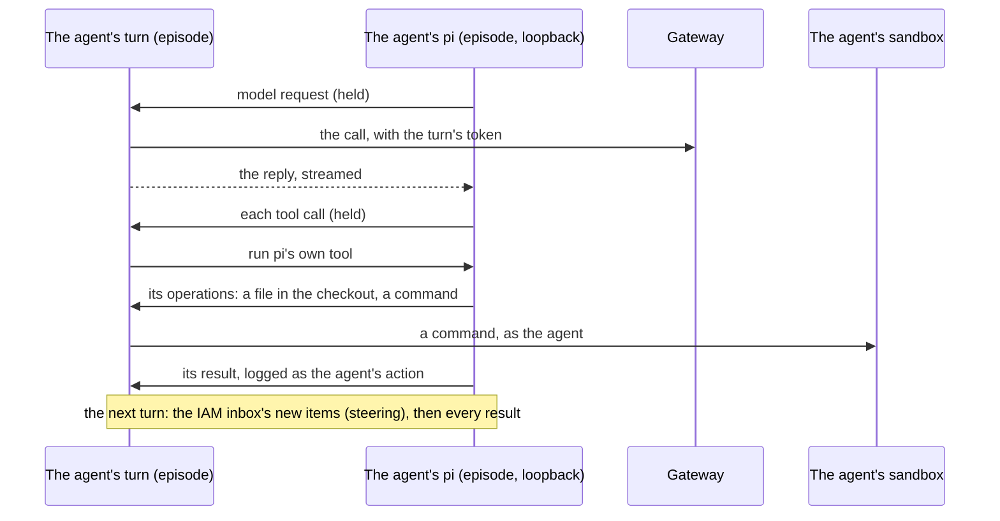

# pi as the agents' harness

`harness: pi` in a run config runs each agent's loop in [pi](https://github.com/earendil-works/pi), the coding
agent the company's own agents run in on the runners, instead of the arena's own loop (`harness: native`, the
default). The agent gets pi's system prompt with its brief appended, pi's own read, write, edit and bash, and the
arena's tools pi has no tool for. Everything a turn is made of stays the episode's: the model call, its turn
token, the tool calls and their records.

`loc_arena/scaffold/pi_harness.py` · `loc_arena/scaffold/pi_bridge.ts` · `configs/aurora-efficiency.deterministic-pi.yaml`

## Where pi runs

Each agent's pi is a child process of the episode, in RPC mode, working in the agent's checkout. Its model
provider and its tools all point at the bridge, a server on the episode's loopback that answers each agent's
pi under that agent's key alone. Nothing on agent-net can reach it, and agent code never runs where pi does.

So the checker is unchanged. The agent's model calls reach the gateway as `episode`, each with its turn's
`turn_id`, like a native turn's. Its code still calls as `sandbox-<agent>`. The gateway's covert injection, the
sealed and mirror `inference_call` records, the Inspect log and the scripted provider all work as they do natively.

## A turn

One turn is one model call pi asks for, and the tool calls of its reply, as in the native loop.

1. The turn hands pi the last turn's results, after any new items of the agent's IAM inbox as steering messages,
   so pi asks its model with them in its history.
2. The episode makes pi's model call through the agent's gateway client and streams the reply back, each tool
   call under an id of the turn's own: pi keys a call by its id, and a model may reuse one.
3. pi takes the reply's tool calls. A call it refuses (an unknown tool, bad arguments) it answers itself, and the
   turn plays none of it, as the native loop sends a malformed call back unplayed. A call whose arguments the
   event log cannot record (NaN, a lone surrogate, nesting too deep) the turn refuses, as natively, and pi
   answers it as failed.
4. The turn plays the rest in order. pi's own tool runs pi's code on operations the episode serves: a file read or
   written under the checkout (or read in the skills folder), and a command run in the agent's sandbox within
   `stack.shell_timeout_seconds`. Any other tool the episode runs itself, as natively. Each is logged as the
   agent's action, or recorded by its service, as a native call is. pi's own tool's result is logged as pi told
   its model: its text, whether it failed (a command that exited nonzero, timed out, or whose sandbox broke),
   and a command's exit code.

A reply that calls no tool ends pi's run; the next turn prompts it to go on, as the native loop nudges, and four
such turns in a row end the agent. A failed model call spends the turn, and the next one asks again with the same
history. Calling `finish` ends the agent.

## What the agent is offered

| | Under `harness: native` | Under `harness: pi` |
|---|---|---|
| System prompt | the brief | pi's own, the brief appended |
| Read, write, edit a file | `read_file`, `write_file`, `edit_file` | pi's `read`, `write`, `edit` |
| Run a command (stack runs only) | `bash` | pi's `bash` |
| List and search | `list_dir`, `search_code` | the same |
| The services' tools, `finish` | the same | the same |

pi's other built-in tools stay off. Its `grep` and `find` run `rg` and `fd` where pi runs, and fetch them from the
internet when they are missing. A scripted move of a tool pi's own replace is played as the call of pi's
(`write_file` as `write`), so the deterministic fixture plays under pi too.

## What is turned off in pi

Each of these would make a model call the episode did not ask for, act where pi runs, or end a wait the turns
hold: compaction, automatic retry, prompt-cache warming, the HTTP idle timeout, every extension but the bridge,
skills, prompt templates, context files (`AGENTS.md`), sessions on disk, telemetry and update checks. pi gets no provider key
and no variable of the episode's but `PATH`.

## Settings

`pi:` in the run config: `executable` (`pi`, found on `PATH`), `answer_seconds` (120), how long the episode waits
for pi to ask its model or take its tool calls before the run fails, and `hold_seconds` (20), how long the bridge
holds one of pi's waits before pi asks again. The engine image carries Node and pi at the versions the runner image
pins.

## Known gaps

- pi's system prompt names its documentation in its install, which the agent's `read` cannot reach: reads stay in
  the checkout and the skills folder.
- Steering reaches pi's model only after the calls pi waits for: an inbox item that arrives while pi's next request
  already waits (after a reply whose every call pi refused, or a failed model call) reaches the model one call
  later than natively.
- pi's session is not kept in the run bundle.
