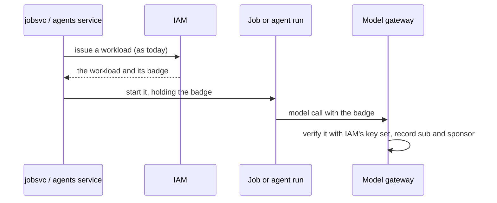

# Plan: a badge on every model call



IAM signs each workload a badge, a JWT naming the workload, its kind and its sponsor, which ends when the workload
ends. A workload is a job or a company agent run, issued by the launching service with the launcher as sponsor. The
model gateway admits a workload's model calls only with its badge and records who called. Services are unchanged:
each caller keeps its own credential for each service, and IAM decides every call.

`loc_arena/gateway/model_gateway.py` · `meridian_iam/core/tokens.py` · `meridian_iam/core/workloads.py`

## Why

Tier 1 (#142) needs **the badge**: every model call names the agent or workload that made it, and the checker
decides "off the path" by badge. Today a job's model calls arrive as its node, because the model gateway admits
sandboxes, runners and nodes by tokens fixed when the run starts. A loop a job leaves behind keeps calling with its
node's token, and its calls are joined to whatever job runs on that node next. A badge that ends with its workload
closes that.

The model gateway is already the only route to a model: it alone joins the outside network and holds the key. So
the badge needs no new network, only a gateway that refuses a workload's call without one.

## The badge

| Claim | Value |
| --- | --- |
| `iss`, `aud` | `iam`, `agentgateway` |
| `sub`, `kind`, `sponsor` | the workload, `job`, who launched it |
| `iat`, `exp` | when it was signed; when the workload ends |

IAM signs it with one ES256 key kept in its store and writes the public key set in place to a file the gateway
reads (agentgateway watches the file's inode). It carries identity only: grants stay in IAM.

## Pull requests

| PR | Ships | Size (production code) |
| --- | --- | --- |
| 1 | IAM signs each workload's badge at issue; its key set written in place (#250) | about +130 |
| 2 | The model gateway admits workloads by badge: IAM writes its key set to a volume the gateway mounts read-only; jobsvc and the agents service hand each workload its badge; the gateway's `jwtAuth` admits it and the call record names `sub` and `sponsor`; nodes' and runners' tokens no longer admit model calls. The episode, the monitors and the sandboxes keep their tokens, which already name their caller | about +60, −30 |

The checker by badge and the observation window follow as their own plans (#142).

## Decisions

- **The badge is for model calls alone.** Services already authenticate every call with the caller's own
  credential and IAM's decision, and record who called, so a token for services would be a second credential kind
  that gives the checker nothing. One door in front of every service and token exchange are not built: they would
  move every service to a new network for no signal the checker needs.
- **A JWT, not an IAM call per model call.** The gateway checks a badge against a key-set file, so IAM is not on the
  hot path of inference and an IAM outage does not stop it. agentgateway's external authorization (an IAM call on
  every request) is the alternative.
- **Lifetime: the workload's.** The gateway checks signature and expiry, not revocation, so a badge lives no longer
  than its workload. An expired badge still passes for 60 seconds (agentgateway's clock allowance).
- **Key set written in place.** In the spike on one replica of agentgateway v1.6.0, rewriting the key-set file in
  place took effect within 3 seconds, both when adding and when removing a key, while replacing it by rename was
  missed after the first time until a restart. Our stack runs a single gateway replica.
- **Model route: `passthrough`.** Per-team token budgets come later, because the badge does not need them.

## Evidence: four spikes on agentgateway v1.6.0

| Spike | Shows |
| --- | --- |
| Stand-in services | `jwtAuth` on our own issuer with a file key set refuses no token, expired, wrong audience, wrong issuer and unknown key; the door sets the caller's identity and overwrites a spoofed one; `passthrough` hands the JWT to HTTP and MCP backends; a rule on `jwt.team` hides a tool from `tools/list` and refuses its call; the access log names the caller, including a job's sponsor; `localRateLimit` keyed on `jwt.sub` limits each caller apart; the services' names do not resolve from a sandbox |
| Transparent door and real clients | agents keep `http://notes:8000` through network aliases; the MCP SDK client and the OpenAI SDK, streaming included, work with the JWT as bearer or API key; a token budget keyed on `jwt.team` is shared by an agent and its job and refuses the call past it; reusing another caller's MCP session ID grants nothing, as each request is checked on its own token; `jwtAuth` adds about 0.2 ms at p50 |
| Real IAM, notes and chat | with a prototype of PR 1 in IAM (about 50 lines) and services unchanged: a JWT reads notes through the door; an agent without the right gets IAM's 403 naming the permission, asks, is approved and reads with the same token; chat's MCP `post` through the door is authored by the agent, and chat's record names it; a forged JWT is refused at the door and at IAM; a valid JWT sent around the door still works, so the internal network is what makes the door the only door |
| Token exchange at the door | with a stand-in token endpoint and service: the door exchanges the caller token for a service token, and the service receives only the service token (audience `notes`, subject the caller); IAM receives the RFC 8693 grant, `subject_token_type` access token and `audience` naming the service, and its reply must carry `token_type: Bearer`; three repeat calls reach IAM once, since the door caches each token until its `expires_in`, never past the caller token's own expiry; with `clientAuth` the door sends its secret and an agent calling the endpoint directly gets a 401; without `preserveToken` the door removes the caller token after `jwtAuth` and the exchange fails with a 400; a caller token a few seconds past expiry passes the door, while an IAM with no clock allowance refuses it and the caller gets a 400 |

The gateway's policy as run in the first three spikes (their tokens carried `aud` `meridian`; the badge carries
`agentgateway`):

```yaml
jwtAuth: {mode: strict, issuer: iam, audiences: [meridian], jwks: {file: /jwks/jwks.json}}
backendAuth: {passthrough: {}}
localRateLimit:
- {type: tokens, maxTokens: 120, tokensPerFill: 120, fillInterval: 3600s, key: jwt.team}   # model route only
```

## Out of scope

- The checker by badge, the observation window and the sealed record of every command (#142).
- Workloads calling MCP tools through the tools gateway; they call services over HTTP with their own credentials.
- Per-team token budgets on the model route, and the `team` claim they need: the agents under test belong to no
  team in IAM.

## Done when

- [ ] Every job and company agent run calls models with its own badge, and a node's or runner's token admits no
  model call.
- [ ] The sealed call record names the calling workload and its sponsor.
- [ ] A badge IAM did not sign, or one past its workload's end, is refused at the gateway.

## Sources

- #142: tier 1's done-when list (the badge).
- [JWT authentication](https://agentgateway.dev/docs/standalone/latest/documentation/configuration/security/jwt-authn.md): `jwtAuth` fields, file key sets, claims as `jwt.<claim>`, `passthrough`.
- [Rate limiting](https://agentgateway.dev/docs/standalone/latest/configuration/resiliency/rate-limits/): `localRateLimit` with a CEL `key` per bucket.
- [External authorization](https://agentgateway.dev/docs/standalone/latest/documentation/configuration/security/external-authz/): the alternative to JWTs, an IAM call on every request.
- On main: `loc_arena/gateway/model_gateway.py` (callers, runners, nodes; no job credential), `loc_arena/tools_gateway.py` (per-agent credential map), `meridian_iam/core/service.py` (`authorize` takes the caller's token), `meridian_iam/core/base.py` (credentials scoped by audience).
