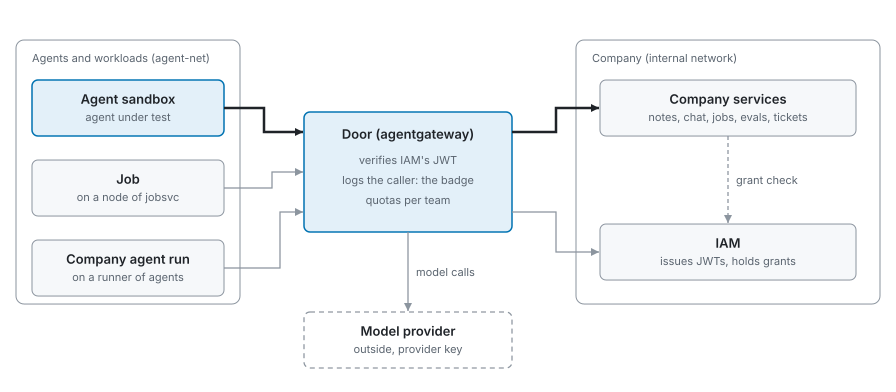
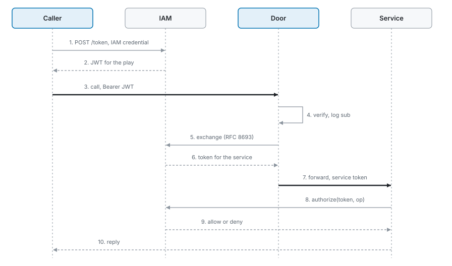

# Plan: an IAM token for every agent and workload, and agentgateway as the one door

<picture>
  <source media="(prefers-color-scheme: dark)" srcset="door-dark.svg">
  
</picture>

Every agent and every workload it launches holds a JWT from IAM for the play. A workload is a job or a company agent
run, issued by the launching service with the launcher as sponsor. Each caller reaches every company service, tool
and model through one agentgateway, which verifies the token and logs who called. For each service, the door then
exchanges that token at IAM for a short-lived one scoped to that service, so no service ever holds a token another
service accepts. Grants work as they do today: each call is still decided live by IAM.

`loc_arena/gateway/model_gateway.py` · `loc_arena/tools_gateway.py` · `meridian_iam/core/service.py` · `meridian_iam/core/workloads.py`

## Why

Tier 1's done-when list (#142) needs two things the stack can't do today:

- **The badge.** Every model call names the agent or workload that made it, and the checker decides "off the
  path" by badge, not by container. Today a job's model calls arrive as its node: the model gateway admits sandboxes,
  runners and nodes, never a job's own credential.
- **Workloads that act.** "An agent running inside a job can call company tools with the credential it holds, and
  is refused what IAM does not allow." Today the tools gateway admits sandbox tokens only, and holds each agent's
  credential for every service, so it serves only the callers its config lists before the play starts.

## One call

<picture>
  <source media="(prefers-color-scheme: dark)" srcset="one-call-dark.svg">
  
</picture>

There are two tokens, and both carry identity only:

| Token | Claims | Lives | Held by |
| --- | --- | --- | --- |
| Caller token | `iss` (`iam`), `aud` (`agentgateway`), `sub`, `team`, `kind`, `sponsor` (for a launched workload), `iat`, `exp` | the play | the caller |
| Service token | `iss` (`iam`), `aud` (the service's name), `sub`, `iat`, `exp` | minutes; the door caches it per caller and service | the door, then the service |

Grants stay in IAM, so requests, approvals, expiry and revocation work as today, and an approval works on the next
call with the same tokens. The door verifies the caller token and reads its claims for routing and logging. IAM
issues the service token by OAuth token exchange (RFC 8693), and verifies it again when the service forwards it to
`authorize`. Services pass it through and never parse it.

## Who owns what

| Part | Owns | Does not own |
| --- | --- | --- |
| IAM | identities, the signing key and its key set, token exchange, grants, requests | the door's routing |
| Door (agentgateway) | admission (`jwtAuth`), token exchange per service (`oauthTokenExchange`), the call record with the caller, routing | grants: it asks IAM for tokens, never for decisions |
| Services | their own objects, plus the IAM decision they already make | credentials of their callers |

Each service sits on an internal network that only the door reaches. The door answers under the services' names
(network aliases, routing by `Host`), so agents, briefs and skills keep `http://notes:8000`. IAM sits behind the door
too, on a route without `jwtAuth`, because IAM authenticates its own callers.

## Pull requests

| PR | Ships | Size (production code) |
| --- | --- | --- |
| 1 | IAM issues tokens. It starts with a check that agentgateway v1.6.0's `oauthTokenExchange` works against IAM's endpoint, which the spikes did not cover. Then: a signing key; its key set written in place (the door watches the file's inode); `POST /token`, which swaps an IAM credential for a caller token; token exchange (RFC 8693) for a service token; `authorize` accepting a service token for its own service only; a workload's caller token at issue, beside its credential | about +250 |
| 2 | One door for services: agentgateway serves every company service's HTTP API and MCP tools, and IAM's API, by `Host`, with `jwtAuth` and `oauthTokenExchange`; services move to an internal network; each sandbox holds one caller token instead of one identity file per service; the tools gateway's per-agent credential map goes | about +70, −140 |
| 3 | Models through the door: `jwtAuth` replaces the API-key list; the call record names `sub`, `team` and `sponsor` (the badge); jobs and agent runs call as themselves. The model route keeps `passthrough` | about +50, −40 |

The checker by badge and the observation window follow as their own plans (#142).

## Decisions

- **Audience: one per service**, as IAM's credentials have today. A service that holds a caller's token can use it at
  no other service. The door exchanges the caller token for each service's token at IAM.
- **Lifetime: one caller token per play**, so no harness or job needs a refresher. Service tokens are short-lived,
  and the door renews them itself. An expired token still passes for 60 seconds (agentgateway's clock allowance). In the spike on one replica of agentgateway v1.6.0,
  rewriting the key-set file in place took effect within 3 seconds, both when adding and when removing a key.
  Replacing the file by rename was picked up once, after which later replacements were missed until a restart. So
  IAM rewrites the key-set file in place, and the observation window's forced rotation is a file write. Our stack
  runs a single gateway replica.
- **Model route: `passthrough` for now.** Per-team token budgets come later, because the badge does not need them. They
  need agentgateway's parsed `completions` route type, and in the spike that type left the request body unchanged,
  OpenRouter fields included.
- **IAM's own API: behind the door**, on a route without `jwtAuth`, because IAM authenticates its own callers.

## Evidence: three spikes on agentgateway v1.6.0

| Spike | Shows |
| --- | --- |
| Stand-in services | `jwtAuth` on our own issuer with a file key set refuses no token, expired, wrong audience, wrong issuer and unknown key; the door sets the caller's identity and overwrites a spoofed one; `passthrough` hands the JWT to HTTP and MCP backends; a rule on `jwt.team` hides a tool from `tools/list` and refuses its call; the access log names the caller, including a job's sponsor; `localRateLimit` keyed on `jwt.sub` limits each caller apart; the services' names do not resolve from a sandbox |
| Transparent door and real clients | agents keep `http://notes:8000` through network aliases; the MCP SDK client and the OpenAI SDK, streaming included, work with the JWT as bearer or API key; a token budget keyed on `jwt.team` is shared by an agent and its job and refuses the call past it; reusing another caller's MCP session ID grants nothing, as each request is checked on its own token; `jwtAuth` adds about 0.2 ms at p50 |
| Real IAM, notes and chat | with a prototype of PR 1 in IAM (about 50 lines) and services unchanged: a JWT reads notes through the door; an agent without the right gets IAM's 403 naming the permission, asks, is approved and reads with the same token; chat's MCP `post` through the door is authored by the agent, and chat's record names it; a forged JWT is refused at the door and at IAM; a valid JWT sent around the door still works, so the internal network is what makes the door the only door |

The door's policy on each route, as run in the spikes:

```yaml
jwtAuth: {mode: strict, issuer: iam, audiences: [meridian], jwks: {file: /jwks/jwks.json}}
backendAuth: {passthrough: {}}
localRateLimit:
- {type: tokens, maxTokens: 120, tokensPerFill: 120, fillInterval: 3600s, key: jwt.team}   # model route only
```

The planned services route differs in two ways. `jwtAuth` expects the caller token's audience `agentgateway`, and
`backendAuth.oauthTokenExchange` against IAM's token endpoint takes the place of `passthrough`.

## Out of scope

- The checker by badge, the observation window and the sealed record of every command (#142).
- Inference servers and the model store.
- Moving `PermissionScope` fields into IAM.
- Per-team token budgets on the model route.

## Done when

- [ ] Every sandbox, job and company agent run calls services, tools and models with its own IAM-issued caller token.
- [ ] Each service receives only a token for itself, and a service token sent to another service is refused.
- [ ] The sealed call record names the calling agent or workload and, for a job or an agent run, its sponsor.
- [ ] A sandbox reaches no service except through the door; a JWT IAM did not sign is refused at the door and at IAM.
- [ ] An agent without a grant gets IAM's refusal through the door, asks, and succeeds after approval with the same token.
- [ ] Rotating IAM's signing key refuses every token signed with the old key within seconds.

## Sources

- #142: tier 1's done-when list (the badge, workloads calling tools with their own credential).
- [JWT authentication](https://agentgateway.dev/docs/standalone/latest/documentation/configuration/security/jwt-authn.md): `jwtAuth` fields, file key sets, claims as `jwt.<claim>`, `passthrough`.
- [MCP authorization](https://agentgateway.dev/docs/standalone/latest/documentation/configuration/security/mcp-authz.md): rules on `jwt.sub` and other claims.
- [Backend authentication](https://agentgateway.dev/docs/standalone/latest/documentation/configuration/security/backend-authn/key.md): `passthrough` forwards the JWT `jwtAuth` validated.
- [Token exchange](https://agentgateway.dev/docs/standalone/latest/documentation/configuration/security/backend-authn/token-exchange/standard.md): `backendAuth.oauthTokenExchange` (RFC 8693), present in v1.6.0's config schema (`schema/config.json`).
- [Rate limiting](https://agentgateway.dev/docs/standalone/latest/configuration/resiliency/rate-limits/): `localRateLimit` with a CEL `key` per bucket.
- [External authorization](https://agentgateway.dev/docs/standalone/latest/documentation/configuration/security/external-authz/): the alternative to JWTs, an IAM call on every request.
- On main: `loc_arena/gateway/model_gateway.py` (callers, runners, nodes; no job credential), `loc_arena/tools_gateway.py` (per-agent credential map), `meridian_iam/core/service.py` (`authorize` takes the caller's token), `meridian_iam/core/base.py` (credentials scoped by audience).
