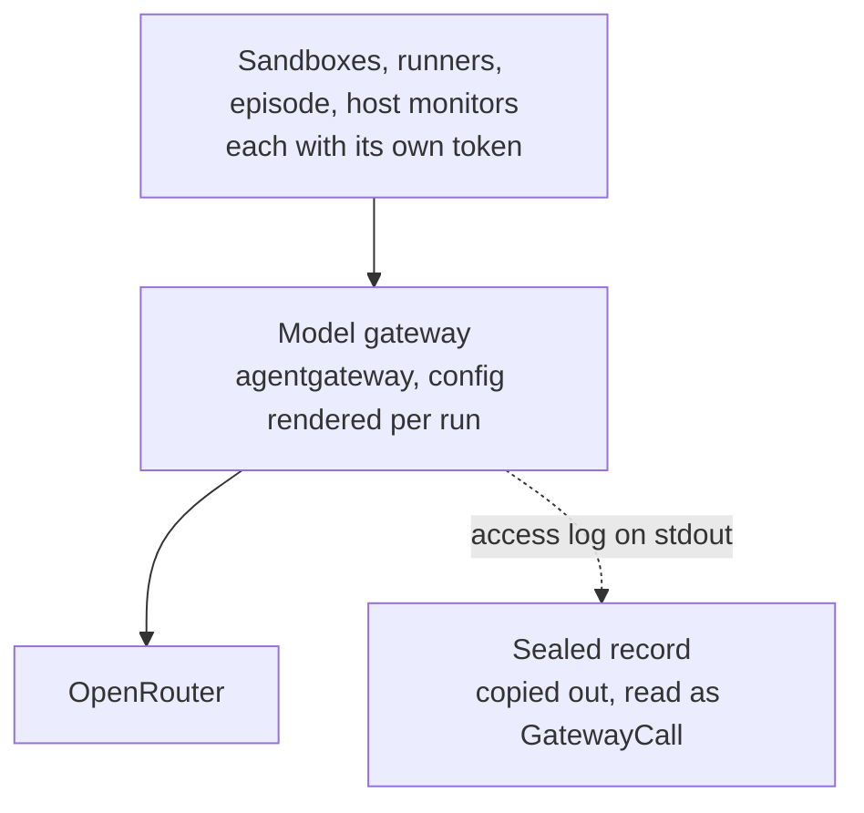

# Design proposal: the model gateway on agentgateway

## Why

The tier 1 proposal (#142) asks the model gateway for:
- a badge on every call;
- the caller's identity from IAM;
- per-team quotas;
- a ledger the company can read;
- monitored and backend routes;
- Meridian model names mapped to real models.

Tiers 2 to 4 add oversight sampling and budgets. In `loc_arena/gateway/proxy.py` each of these is new code we write.
agentgateway, which already runs as our tools gateway, has them as configuration.

A spike (branch `spike/agentgateway-llm`, `scripts/spike_agentgateway_llm/NOTES.md`) checked this against a mock
upstream and against OpenRouter:

| Check | Result |
| --- | --- |
| parity with `proxy.py` | 27/27 |
| the tier 1 features | 23/24 |
| live OpenRouter calls | six, including streaming and the Messages API |

This proposal makes the change in two steps, so that the risky part (the sealed record) lands with no new behaviour.

## Step 1: swap, with no new features

The callers, paths and runner limits stay the same. What changes:

**1. Every caller presents a token.** agentgateway cannot name a caller by reverse DNS, so it admits callers by the
SHA-256 of their token, as the tools gateway already does. The record then names the caller from its token.

| Caller | Token today | Change |
| --- | --- | --- |
| sandboxes | `sandbox_token` | pi's `models.json` key becomes `!cat` of the token file, which pi reads on every request |
| runners | `runner_token_<runner>` | the same change in `sandbox_server/pi_on_gateway.py` |
| episode container | none (`held-by-the-gateway`) | a new token secret, sent by `OpenRouterProvider` |
| monitors on the host | none (placeholder) | a new token held by the host, sent by `OpenRouterProvider` |

**2. The config is rendered per run.** A new module beside `loc_arena/tools_gateway.py` renders it, in binds mode, as
in the spike's `parity.yaml`:

- **Routes:** exact routes for `chat/completions`, `completions` and `models` under `/api/v1`, plus a runner route.
  The runner route holds the runners' model allowlist and their calls-per-play cap. `runner_pool.py` points runners at
  it.
- **Required settings,** each found by a failed check in the spike:
  - a policy that reads the request body, so a call whose upstream is never reached keeps its request in the record;
  - `accept-encoding` removed toward the provider, so the record holds the reply's text, not gzip bytes.
- **Rate-limit counts.** The config is never reloaded during a play, and the gateway is recreated before the honest
  twin, as it is today. So the reset-on-reload behaviour the spike found cannot touch the runners' count in this step.

**3. The sealed record.** This changes the sealed log's format: a one-way door.

- It becomes the gateway's access log on stdout.
- `episode_stack.py` copies it with `docker compose logs --no-log-prefix gateway`. The copy runs before
  `renew_services` recreates the gateway for the twin, and again at the end.
- The gateway service's compose `logging` is set explicitly, with no rotation, so a host's Docker defaults cannot cut
  the record.
- An adapter reads each line as a `GatewayCall`. `complete` is derived: 2xx, and a stream ends in `data: [DONE]`. With
  the adapter, `explorer/reasoning.py` and `tests/integration/test_stack_reach.py` stay as they are.

**4. Settings.**
- `GatewaySettings` keeps `upstream`, `allowed_paths`, `port`, `runner_models`, `runner_calls_per_play` and
  `timeout_seconds`.
- `call_log` goes.
- The agentgateway image is pinned beside the tools gateway's (`ghcr.io/agentgateway/agentgateway:v1.6.0`).

**5. Tests.**
- **Kept behaviour.** The 14 tests in `test_gateway_proxy.py` that check behaviour we keep become integration tests of
  the rendered config against the real agentgateway binary and a mock upstream, ported from `probe_parity.py`.
- **Dropped tests.** The 4 that check how `proxy.py` works go with it.
- **New tests:** renderer unit tests.
- **Out of scope.** `test_gateway_stamps.py` and `test_gateway_messages.py` cover the in-process path
  (`gateway/core.py`), which this proposal leaves alone.

**Estimated delta:**

| | Removed | Added | Net |
| --- | --- | --- | --- |
| production code | `proxy.py` −259, `GatewaySettings` about −30 | renderer about +100, log copy and adapter about +30, caller tokens about +20 | about −140 |
| tests | `test_gateway_proxy.py` −294 | integration tests about +180, renderer tests about +40 | about −75 |
| **total** | | | **about −215** |

**Step 1 is done when:**
- [ ] the ported parity tests pass in CI against the pinned image;
- [ ] the deterministic run (seed 7) matches main;
- [ ] a live run's calls by status and model match a run on main, and every call has a record with caller, request
  and reply;
- [ ] the key appears in no log, and no caller reaches the gateway without a token;
- [ ] the explorer's reasoning view reads the new record unchanged.

## Step 2: the tier 1 pieces, one PR each

Each piece is a config change with its own test. The spike shows each one working.

| Piece | How |
| --- | --- |
| the badge | `jwtAuth` over IAM's key set, or `extAuthz` to IAM (decision 1) |
| routes by model name | llm mode: Meridian models to their deployments, provider models to OpenRouter, with a rule allowing only the API paths we serve |
| backend route | a model key from the weight files, plus the badge of the job it runs in |
| team quotas | keyed by the badge's team (decision 2) |
| ledger | the database sink, plus a reader for security |
| observation-window cap | a rate limit written into the live config when the window starts |
| harnesses | Claude Code's `apiKeyHelper` and pi's `!command` key carry a rotating badge |

## Decisions

Step 1 needs only decision 4. The rest come before step 2.

1. **The badge's form.** Both forms ran in the spike.
   - **A JWT signed by IAM.** The gateway checks it on its own. Revoking one means rotating the signing key or keeping
     lifetimes short.
   - **IAM's opaque workload secret, checked live through `extAuthz`.** That costs one IAM call per model call, and
     revocation takes effect at once.
2. **Quotas across reloads.** Any reload, of the config or of a watched file such as the key set, resets
   agentgateway's local rate-limit counts. Options:
   - accept the reset and move the runners' cap to a key budget in tokens or USD, which survives reloads;
   - run a rate-limit service whose counts survive.
3. **Meridian model names in replies.** Two options:
   - `meridian-serving` deployments answer under their own name, as #142 designs;
   - give up streaming for aliased models.

   A plain alias shows agents the provider's model name.
4. **The sealed record's new format,** as in step 1, point 3.

## Risks

- **One young upstream holds our evidence.** agentgateway v1.6.0 came out in October 2026, and its release notes
  already change LLM behaviour. The pinned version and the ported parity tests are the gate for every upgrade.
- **Correctness moves into config.** A wrong CEL rule fails quietly. The spike found two silent holes, the gzip body
  and llm mode's open paths, both closed by settings above. The integration tests carry this weight.
- **What it cannot express needs another service.** One example is requests counted per team across reloads.

## Sources

- agentgateway v1.6.0 release: https://github.com/agentgateway/agentgateway/releases/tag/v1.6.0 (the version pinned)
- agentgateway config reference: https://github.com/agentgateway/agentgateway/blob/v1.6.0/schema/config.md
  (routes, `apiKey`, `jwtAuth`, `extAuthz`, `localRateLimit`, key budgets, llm mode)
- agentgateway CEL reference: https://github.com/agentgateway/agentgateway/blob/v1.6.0/schema/cel.md
  (`apiKey.*`, `jwt.*`, `extauthz.*`, body variables used in records and rules)
- Claude Code `apiKeyHelper`: https://code.claude.com/docs/en/settings-reference#apikeyhelper (a credential refreshed
  during a session)
- pi custom providers: https://github.com/badlogic/pi-mono/blob/main/packages/coding-agent/docs/models.md (a
  `!command` key is resolved on every request)
- Docker logging configuration: https://docs.docker.com/engine/logging/configure/ (per-container `log-opts` and the
  daemon's rotation defaults)
