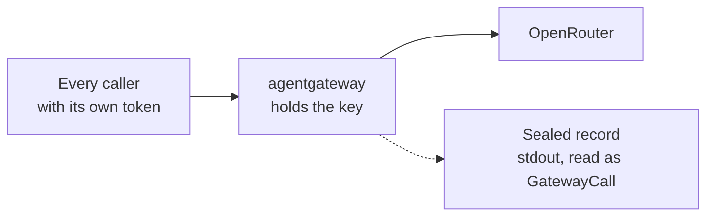
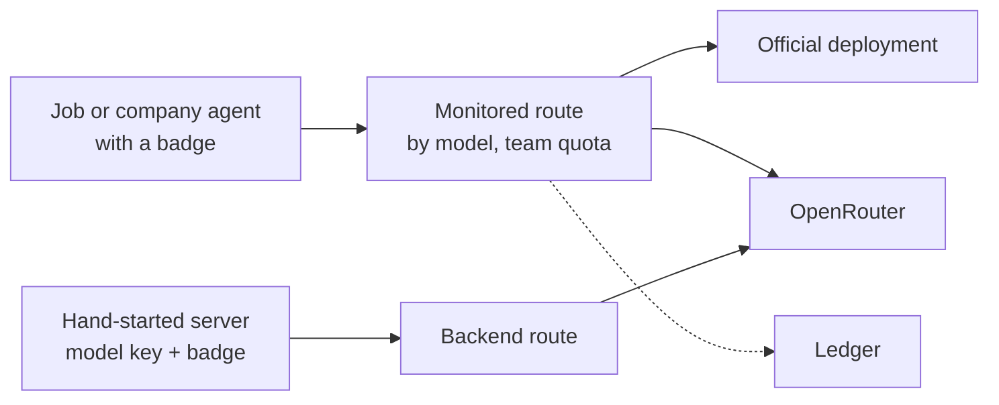

# Design proposal: the model gateway on agentgateway

## Step 1: swap `proxy.py`, same behaviour

| What changes | How |
| --- | --- |
| callers | send a token; the episode and the host monitors get one |
| config | rendered per run beside `tools_gateway.py`; buffers request bodies; drops `accept-encoding` |
| sealed record | copied from stdout before the twin, with log rotation off; an adapter keeps the readers. **One-way door** |
| tests | 14 of the 18 proxy tests become integration tests against the real binary |
| lines | about −140 code, about −75 tests |

## Step 2: the tier 1 pieces, one PR each

The pieces, all of which work in the spike:
- the badge
- routing by model name
- the backend route
- team quotas
- the ledger
- the observation-window cap

## Decide before step 2

1. **Badge:** a JWT signed by IAM, which the gateway checks itself, or IAM's opaque secret checked live
   through `extAuthz`, which revokes at once.
2. **Quotas:** any reload resets them. Move caps to key budgets, or run a rate-limit service.
3. **Model names in replies:** deployments answer under their own name, or aliased models lose streaming.

**Risk:** a young upstream holds our evidence. agentgateway is pinned at v1.6.0, and the parity tests gate every
upgrade.

**Evidence:** `scripts/spike_agentgateway_llm/NOTES.md` on `spike/agentgateway-llm`:

| Probe | Result |
| --- | --- |
| parity with `proxy.py` | 27/27 |
| tier 1 features | 23/24 |
| live OpenRouter calls | 6 |

## Sources

- agentgateway v1.6.0: https://github.com/agentgateway/agentgateway/releases/tag/v1.6.0 (the pinned version)
- Config reference: https://github.com/agentgateway/agentgateway/blob/v1.6.0/schema/config.md (routes, auth, rate
  limits, budgets, llm mode)
- Docker logging: https://docs.docker.com/engine/logging/configure/ (the daemon's rotation defaults)
